# Business_Management_And_Analytics_Backend

A Django-based backend for multi-branch business management. It covers products, inventory, invoicing, suppliers, subscriptions, employee management, analytics summaries, chat, notifications, and activity logging.

**Features**
- Multi-business, multi-branch setup with customers and staff roles
- Product catalog with categories, GST rates, SKU uniqueness, and profitability
- Inventory with stock transactions and purchase-order integration
- Invoicing with line items and customer linkage
- Supplier management with purchase orders
- Monthly financial summaries, product performance, and cost categorization
- Subscriptions, plans, and usage tracking
- In-app chat, broadcast groups, and notifications
- Activity logging across modules

**Tech Stack**
- Python, Django, Django REST Framework
- PostgreSQL (via `psycopg` / `psycopg2-binary`)
- Redis + Celery for background jobs
- Django Channels for realtime features
- Cloudinary storage for chat media

**Project Structure**
- `apps/activity_log`: audit trails
- `apps/analytics`: analytics permissions (no DB tables)
- `apps/base`: shared base models
- `apps/business`: business, branch, and customers
- `apps/chat`: conversations, messages, broadcasts
- `apps/cost`: monthly financial summaries and cost breakdown
- `apps/employee`: roles, branch assignments, employee details
- `apps/inventory`: inventory, stock items, transactions
- `apps/invoice`: invoices and line items
- `apps/master`: country, state, city masters
- `apps/notification`: user notifications
- `apps/product`: products and categories
- `apps/subscription`: plans, subscriptions, usage
- `apps/supplier`: suppliers and purchase orders
- `apps/tasks`: internal task management
- `apps/user`: custom user model

**Setup**
1. Create a virtual environment and install dependencies.
2. Copy `.env.template` to `.env` and fill in required values.
3. Run migrations.
4. Start the Django server.

```bash
python -m venv .venv
source .venv/bin/activate
pip install -r requirements.txt
cp .env.template .env
python manage.py migrate
python manage.py runserver
```

**Background Workers**
```bash
celery -A bma worker -l info
celery -A bma beat -l info
```

**Environment Variables**
- `DEBUG`, `SECRET_KEY`, `CORS_ALLOW_ALL_ORIGINS`
- `DB_NAME`, `DB_USER`, `DB_PASS`, `DB_HOST`, `DB_PORT`
- `REDIS_URL`, `CELERY_BROKER_URL`, `CELERY_RESULT_BACKEND`
- `ACCESS_TOKEN_LIFETIME`, `REFRESH_TOKEN_LIFETIME`
- `EMAIL_BACKEND`, `EMAIL_HOST`, `EMAIL_PORT`, `EMAIL_USE_TLS`, `EMAIL_HOST_USER`, `EMAIL_HOST_PASSWORD`, `DEFAULT_FROM_EMAIL`

**API Schema**
- OpenAPI snapshot: `schema.yml`

**Database ER Diagram**


Notes:
- All models inheriting `BaseModel` include: `id`, `created_at`, `updated_at`, `created_by`, `updated_by`, `is_deleted`, `is_active`.
- Audit relations (`created_by`, `updated_by`) point to `bma_user` and are not drawn for every table to keep the diagram readable.

```mermaid
erDiagram
  BMA_USER {
    int id PK
    string username
    string email
    string mobile_number
    string first_name
    string last_name
    string profile_picture
  }

  BMA_COUNTRY {
    int id PK
    string name
  }

  BMA_STATE {
    int id PK
    int country_id FK
    string name
  }

  BMA_CITY {
    int id PK
    int state_id FK
    string name
  }

  BMA_BRANCH_ADDRESS {
    int id PK
    string address_line_1
    string address_line_2
    int city_id FK
    string pin_code
  }

  BMA_EMPLOYEE_ADDRESS {
    int id PK
    string address_line_1
    string address_line_2
    int city_id FK
    string pin_code
  }

  BMA_BUSINESS {
    int id PK
    string name
    string gst_number
    string description
  }

  BMA_BRANCH {
    int id PK
    int business_id FK
    int address_id FK
    string name
    string contact_number
    bool is_default
  }

  BMA_BUSINESS_CUSTOMER {
    int id PK
    int business_id FK
    string name
    string mobile_number
    string email
    int age
    string gender
    datetime date_joined
  }

  BMA_USER_BUSINESS_ROLE {
    int id PK
    int user_id FK
    int business_id FK
    string role
  }

  BMA_USER_BRANCH {
    int id PK
    int user_id FK
    int branch_id FK
  }

  BMA_USER_BRANCH_WORK {
    int id PK
    int user_id FK
    int branch_id FK
    string work_type
  }

  BMA_EMPLOYEE_DETAILS {
    int id PK
    int user_id FK
    int address_id FK
    int salary
    string bio
  }

  BMA_PRODUCT_CATEGORY {
    int id PK
    int business_id FK
    string name
    string description
  }

  BMA_PRODUCT {
    int id PK
    int business_id FK
    int product_category_id FK
    string name
    string description
    decimal base_price
    decimal cost_price
    decimal input_gst_rate
    decimal output_gst_rate
    decimal net_profit
    string sku
    int low_stock_limit
  }

  BMA_INVENTORY {
    int id PK
    int business_id FK
    int branch_id FK
  }

  BMA_INVENTORY_PRODUCT {
    int id PK
    int inventory_id FK
    int product_id FK
    int stock_quantity
  }

  BMA_INVENTORY_TRANSACTION {
    int id PK
    int inventory_id FK
    int purchase_order_id FK
    string action
    string description
  }

  BMA_INVENTORY_TRANSACTION_ITEM {
    int id PK
    int transaction_id FK
    int product_id FK
    int quantity
  }

  BMA_SUPPLIER {
    int id PK
    int business_id FK
    string name
    string contact_person
    string email
    string mobile_number
    string gst_number
    string address
    string api_url
    string api_key_hash
    bool integration_active
  }

  BMA_PURCHASE_ORDER {
    int id PK
    int business_id FK
    int branch_id FK
    int supplier_id FK
    date order_date
    string status
    decimal total_amount
    string notes
    datetime received_at
    string external_po_id
  }

  BMA_PO_ITEM {
    int id PK
    int purchase_order_id FK
    int product_id FK
    int quantity
    decimal unit_cost
    decimal subtotal
  }

  BMA_INVOICE {
    int id PK
    int business_id FK
    int branch_id FK
    int customer_id FK
    string payment_mode
    decimal total_amount
    decimal sub_total
    datetime payment_date
    string transaction_id
  }

  BMA_PRODUCT_INVOICE {
    int id PK
    int product_id FK
    int invoice_id FK
    int quantity
    decimal base_price
    decimal selling_price
  }

  BMA_MONTHLY_FINANCIAL_SUMMARY {
    int id PK
    int business_id FK
    int branch_id FK
    int year
    int month
    decimal total_revenue
    int invoice_count
    decimal cost_of_goods_sold
    decimal operating_expenses
    decimal salary_expenses
    decimal output_gst
    decimal input_gst
  }

  BMA_MONTHLY_PRODUCT_PERFORMANCE {
    int id PK
    int product_id FK
    int monthly_summary_id FK
    int quantity
    decimal cost
    decimal revenue
  }

  BMA_COST_CATEGORY {
    int id PK
    int business_id FK
    string name
    string description
  }

  BMA_MONTHLY_COST_CATEGORY {
    int id PK
    int cost_category_id FK
    int monthly_summary_id FK
    decimal cost
  }

  BMA_SUBSCRIPTION_PLAN {
    int id PK
    string name
    decimal price
    int duration_days
    int max_products
    int max_invoices
    int max_staff
    int max_branches
    bool has_advanced_analytics
    bool has_chat
    bool has_api_access
    bool is_active
  }

  BMA_SUBSCRIPTION {
    int id PK
    int business_id FK
    int plan_id FK
    decimal price
    string plan_name
    int duration_days
    int max_products
    int max_invoices
    int max_staff
    int max_branches
    bool has_advanced_analytics
    bool has_chat
    bool has_api_access
    datetime start_date
    datetime end_date
    string payment_mode
    int transaction_id
    datetime payment_date
    bool is_trial
    bool is_active
    string payment_reference
  }

  BMA_PLAN_USAGE {
    int id PK
    int subscription_id FK
    int product_created
    int invoices_created
    int staff_created
    int branches_created
  }

  BMA_CONVERSATION {
    int id PK
    int user1_id FK
    int user2_id FK
  }

  BMA_MESSAGE {
    int id PK
    int sender_id FK
    int conversation_id FK
    string text
    string media
    string message_type
    bool is_updated
    string deleted_text
  }

  BMA_BROADCAST_GROUP {
    int id PK
    int user_id FK
    string name
  }

  BMA_BROADCAST_GROUP_MEMBER {
    int id PK
    int user_member_id FK
    int broadcast_group_id FK
  }

  BMA_NOTIFICATION {
    int id PK
    int user_id FK
    int actor_id FK
    string title
    string content
    string action_type
    string action_link
    bool is_read
  }

  BMA_TASK {
    int id PK
    int business_id FK
    int assignee_id FK
    int assigned_by_id FK
    string status
    string title
    string description
    string remarks
    datetime completed_at
  }

  BMA_ACTIVITY_LOG {
    int id PK
    int business_id FK
    int branch_id FK
    int actor_id FK
    string action
    string module
    string target_model
    int target_id
    string message
    json meta
  }

  BMA_COUNTRY ||--o{ BMA_STATE : "has"
  BMA_STATE ||--o{ BMA_CITY : "has"
  BMA_CITY ||--o{ BMA_BRANCH_ADDRESS : "has"
  BMA_CITY ||--o{ BMA_EMPLOYEE_ADDRESS : "has"

  BMA_BUSINESS ||--o{ BMA_BRANCH : "has"
  BMA_BRANCH_ADDRESS ||--o{ BMA_BRANCH : "located_at"
  BMA_BUSINESS ||--o{ BMA_BUSINESS_CUSTOMER : "has"

  BMA_USER ||--o{ BMA_USER_BUSINESS_ROLE : "has"
  BMA_BUSINESS ||--o{ BMA_USER_BUSINESS_ROLE : "has"

  BMA_USER ||--o{ BMA_USER_BRANCH : "assigned"
  BMA_BRANCH ||--o{ BMA_USER_BRANCH : "has"

  BMA_USER ||--o{ BMA_USER_BRANCH_WORK : "assigned"
  BMA_BRANCH ||--o{ BMA_USER_BRANCH_WORK : "has"

  BMA_USER ||--|| BMA_EMPLOYEE_DETAILS : "details"
  BMA_EMPLOYEE_ADDRESS ||--o{ BMA_EMPLOYEE_DETAILS : "has"

  BMA_BUSINESS ||--o{ BMA_PRODUCT_CATEGORY : "has"
  BMA_PRODUCT_CATEGORY ||--o{ BMA_PRODUCT : "has"
  BMA_BUSINESS ||--o{ BMA_PRODUCT : "has"

  BMA_BUSINESS ||--o{ BMA_INVENTORY : "has"
  BMA_BRANCH ||--|| BMA_INVENTORY : "inventory"
  BMA_INVENTORY ||--o{ BMA_INVENTORY_PRODUCT : "stocks"
  BMA_PRODUCT ||--o{ BMA_INVENTORY_PRODUCT : "stocked"
  BMA_INVENTORY ||--o{ BMA_INVENTORY_TRANSACTION : "records"
  BMA_PURCHASE_ORDER ||--o{ BMA_INVENTORY_TRANSACTION : "linked"
  BMA_INVENTORY_TRANSACTION ||--o{ BMA_INVENTORY_TRANSACTION_ITEM : "items"
  BMA_PRODUCT ||--o{ BMA_INVENTORY_TRANSACTION_ITEM : "moved"

  BMA_BUSINESS ||--o{ BMA_SUPPLIER : "has"
  BMA_BUSINESS ||--o{ BMA_PURCHASE_ORDER : "places"
  BMA_BRANCH ||--o{ BMA_PURCHASE_ORDER : "placed_by"
  BMA_SUPPLIER ||--o{ BMA_PURCHASE_ORDER : "receives"
  BMA_PURCHASE_ORDER ||--o{ BMA_PO_ITEM : "items"
  BMA_PRODUCT ||--o{ BMA_PO_ITEM : "ordered"

  BMA_BUSINESS ||--o{ BMA_INVOICE : "has"
  BMA_BRANCH ||--o{ BMA_INVOICE : "issued_at"
  BMA_BUSINESS_CUSTOMER ||--o{ BMA_INVOICE : "billed"
  BMA_INVOICE ||--o{ BMA_PRODUCT_INVOICE : "items"
  BMA_PRODUCT ||--o{ BMA_PRODUCT_INVOICE : "sold"

  BMA_BUSINESS ||--o{ BMA_MONTHLY_FINANCIAL_SUMMARY : "summarizes"
  BMA_BRANCH ||--o{ BMA_MONTHLY_FINANCIAL_SUMMARY : "branch"
  BMA_MONTHLY_FINANCIAL_SUMMARY ||--o{ BMA_MONTHLY_PRODUCT_PERFORMANCE : "products"
  BMA_PRODUCT ||--o{ BMA_MONTHLY_PRODUCT_PERFORMANCE : "performance"
  BMA_BUSINESS ||--o{ BMA_COST_CATEGORY : "has"
  BMA_COST_CATEGORY ||--o{ BMA_MONTHLY_COST_CATEGORY : "grouped"
  BMA_MONTHLY_FINANCIAL_SUMMARY ||--o{ BMA_MONTHLY_COST_CATEGORY : "costs"

  BMA_SUBSCRIPTION_PLAN ||--o{ BMA_SUBSCRIPTION : "plans"
  BMA_BUSINESS ||--o{ BMA_SUBSCRIPTION : "subscribes"
  BMA_SUBSCRIPTION ||--o{ BMA_PLAN_USAGE : "usage"

  BMA_USER ||--o{ BMA_CONVERSATION : "user1"
  BMA_USER ||--o{ BMA_CONVERSATION : "user2"
  BMA_CONVERSATION ||--o{ BMA_MESSAGE : "messages"
  BMA_USER ||--o{ BMA_MESSAGE : "sends"
  BMA_USER ||--o{ BMA_BROADCAST_GROUP : "owns"
  BMA_BROADCAST_GROUP ||--o{ BMA_BROADCAST_GROUP_MEMBER : "members"
  BMA_USER ||--o{ BMA_BROADCAST_GROUP_MEMBER : "member"

  BMA_USER ||--o{ BMA_NOTIFICATION : "receives"
  BMA_USER ||--o{ BMA_NOTIFICATION : "actor"

  BMA_BUSINESS ||--o{ BMA_TASK : "tasks"
  BMA_USER ||--o{ BMA_TASK : "assignee"
  BMA_USER ||--o{ BMA_TASK : "assigned_by"

  BMA_BUSINESS ||--o{ BMA_ACTIVITY_LOG : "logs"
  BMA_BRANCH ||--o{ BMA_ACTIVITY_LOG : "logs"
  BMA_USER ||--o{ BMA_ACTIVITY_LOG : "actor"
```


